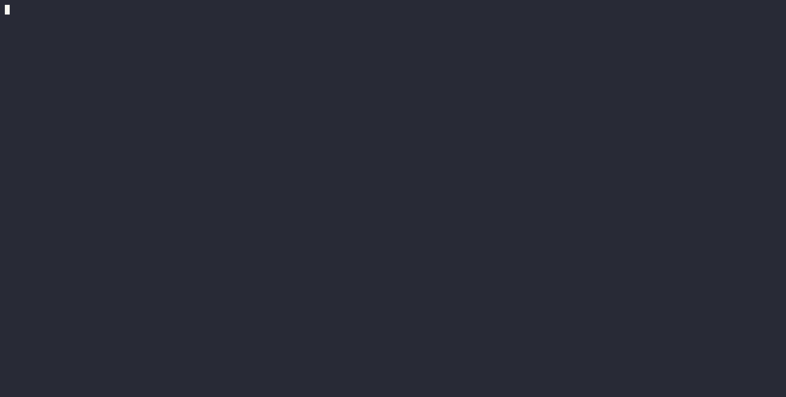

# Pi Codex App Server

Use the same Pi session from the Pi terminal and Codex clients. Pi executes the work; this bridge exposes history, live events, models, and host operations through the Codex app-server protocol.

This is the [AdamsGH fork](https://github.com/AdamsGH/pi-codex-app-server) of [Lqm1/pi-codex-app-server](https://github.com/Lqm1/pi-codex-app-server). Its npm package is `@pi-switch/pi-codex-app-server`. The executable remains `pi-codex-app-server`. The unscoped npm package belongs to upstream and does not install this fork.



Pi remembers a code, Codex CLI resumes the same session and recalls it, and a final reply from Pi appears in both clients. Recorded with Pi 1.2.0 and Codex CLI 0.162.1. See [the recording instructions](docs/showcase.md) to reproduce it.

## Differences from upstream

The comparison below uses upstream commit [`81f9d1b`](https://github.com/Lqm1/pi-codex-app-server/tree/81f9d1b1de2e942bc65df8cd830d10cf3d5a1340) as the fork baseline.

| Area | Changes in this fork |
| --- | --- |
| Live Pi session | Attach to an already running native Pi TUI. Its owner executes writes; subscribers receive the same events and history. Upstream's baseline used daemon-owned sessions and described native TUI attachment as future work. |
| Reconnection and turn state | Recover active-turn items and requested history pages, fan out lifecycle events to clients, preserve relay sequence counters, and clean up subscriptions on disconnect. Reading or resuming history does not rewrite the Pi session file. |
| Desktop discovery | Publish sessions as projects or unassigned chats, apply per-client catalog visibility, and synchronize new unassigned chats through a separate native desktop adapter. Existing pinned and custom-section placements are preserved. |
| Host operations | Implement host process lifecycle, session forks, and filesystem watch subscriptions. Distinguish implemented operations, neutral compatibility responses, and explicitly unsupported requests. |
| Protocol compatibility | Generate server identity and dispatch contracts from the pinned Codex 0.162.1 snapshot. Protocol updates validate staged output and retain recovery backups. |
| Skills | Remove the bundled repository skill collection and its implicit instructions. `skills/list` still discovers user-installed Pi skills; the bridge does not install a collection. |
| Distribution and maintenance | Publish under `@pi-switch/pi-codex-app-server`, retain upstream notices, pin a compatible Pi SDK family, and add user/developer guides, CI, clean-package checks, and a portable sidebar acceptance command. |

The stdio/WebSocket transports, ChatGPT Remote Control, Pi-owned authentication, model catalog, and history projection originate in upstream. This fork extends those foundations.

The native desktop adapter uses a private, version-sensitive host-tools interface. Automatic sidebar membership and ordering passed a live acceptance check. Visible streaming, failed-tool rendering, and final spinner behavior still require visual acceptance; passing protocol tests does not certify them.

## Capabilities and limits

- Codex CLI and desktop attach to a native Pi TUI session. Input, replies, reasoning, and tool events share one writer and one history.
- The footer shows `codex: connected` when the session bridge is attached and the daemon is running. Connection details remain available through `/codex-server status`.
- If a native Pi window cannot acquire the session lease, it stays usable without app-server attachment. The footer shows `codex: disconnected (session in use)` or `codex: disconnected (bridge unavailable)`. Run `/reload` to retry attachment. Disconnected windows use native Pi behavior; the app-server does not coordinate their history writes with the attached owner.
- The daemon survives client disconnects and Pi extension reloads. Reconnecting clients recover history and active-turn items.
- ChatGPT Remote Control uses Pi's OpenAI OAuth credentials.
- Publication settings control exposed history. Repository roots become projects; unassigned sessions use the Pi section.
- A separate desktop adapter adds newly published unassigned chats through native host tools, preserving explicit section and pinned placements.
- Requests use a pinned protocol snapshot. Unsupported operations fail explicitly.

Pi's execution permissions apply. Codex sandbox and approval settings do not create a sandbox around Pi. Archiving preserves history; `thread/delete` permanently deletes the Pi JSONL file. No skill collection is installed by this package.

## Compatibility

| Component            | Verified baseline                            |
| -------------------- | -------------------------------------------- |
| Node.js              | 22.19 or newer required; CI checks 24 and 26 |
| Pi packages          | 1.2.0; declared peer range 1.2.x             |
| Codex protocol / CLI | 0.162.1, recorded in the vendored manifest   |
| Codex desktop        | Windows 26.1007.2314.0                       |
| Development Bun      | 1.4.3                                        |

Windows is the verified desktop target. Linux CI checks core protocol and packaging, not desktop or Remote Control UI. Other desktop platforms require an explicit native endpoint and have not passed live acceptance here. Native host tools are a private, version-sensitive interface. Visible streaming and completed-turn rendering remain separate acceptance checks.

## Install and connect

The scoped npm command becomes available after the first fork release:

```sh
pi install npm:@pi-switch/pi-codex-app-server
```

Until then, build a checkout and install it as a local Pi package:

```sh
bun install --frozen-lockfile
bun run build
pi install /absolute/path/to/pi-codex-app-server
```

Use Bun 1.4.3 for installation. If system Bun cannot read `bun.lock`, use `npm exec --yes --package=bun@1.4.3 -- bun install --frozen-lockfile`. Do not regenerate the lockfile with an older Bun.

Open Pi. After updating an existing installation, run `/reload` when idle. Then run `/codex-server status` and copy its `codex --remote <URL> resume <Pi-session-ID>` command into another pane. Resume the same session ID; a fork is a different conversation.

For desktop or ChatGPT connected-host access, follow [the user guide](docs/user-guide.md). The [live desktop adapter](docs/sidebar-sync.md#live-desktop-adapter) and offline project importer serve different purposes. The importer requires desktop to be closed.

## Documentation

- [User guide](docs/user-guide.md): installation, connections, configuration, updates, troubleshooting, and removal.
- [Architecture](docs/architecture.md): processes, ownership, authentication, storage, and recovery.
- [Development](docs/development.md): setup, checks, migrations, protocol updates, package verification, and release preparation.
- [Session publication](docs/session-export.md): history visibility settings.
- [Sidebar integration](docs/sidebar-sync.md): native synchronization and offline import.
- [Architecture decisions](docs/adr/): retained decisions and their current status.

## Repository layout

| Path | Role |
| --- | --- |
| `src/pi/`, `src/extension/` | Pi runtime, history, TUI ownership, control commands |
| `src/server/`, `src/remote/`, `src/transports/` | Dispatch, Remote Control, transport lifecycle |
| `src/desktop/`, `src/sidebar/` | Native desktop operations and offline import |
| `src/storage/`, `drizzle/` | SQLite schema and versioned migrations |
| `src/protocol/`, `vendor/` | Validation and pinned generated contracts |
| `scripts/`, `test/` | Build, generation, package and acceptance checks |

`drizzle/` is required at runtime. `vendor/` is intentionally committed and updated with `bun run protocol:sync`; it is not continuously mirrored. [UPSTREAM.md](vendor/openai-codex-app-server-protocol/UPSTREAM.md) describes the update contract.

The project uses [Apache-2.0](LICENSE). See [NOTICE](NOTICE) for provenance and [CHANGELOG.md](CHANGELOG.md) for fork changes and retained upstream history.
