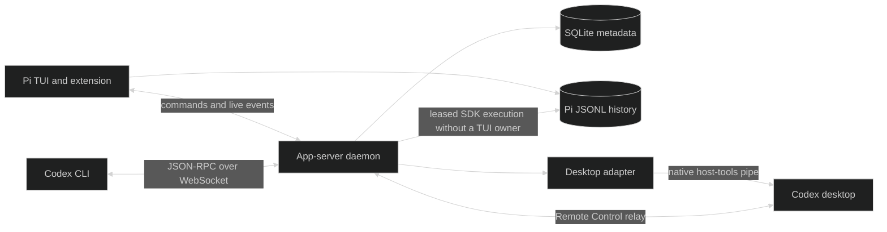

# Architecture

## Processes and ownership

The control extension starts and inspects the daemon, publishes the current Pi session's presence, and exposes an authenticated loopback owner channel. The daemon delegates start, steer, interrupt, and compaction to that TUI. Without a live owner it acquires a session lease before loading an SDK runtime. Two writers cannot hold the same session lease.

The owner channel and daemon WebSocket are different endpoints. Owner authentication does not make the direct daemon WebSocket safe for public listening. Remote Control uses its own enrolled transport.

A native Pi session is an ordinary TUI-owned session. A shared session is the same history exposed to multiple clients while one TUI or daemon owns execution. A connected host is the machine registered for Remote Control. A project is a repository root or explicit server catalog entry, not a ChatGPT workspace.

## Client state and recovery

Each connection initializes before sending requests. Notifications and requests are validated against generated contracts. Clients can opt out of notification methods. Catalog observers receive activity without opening a conversation; full item events require subscription.

Resume can return a separate paginated history view and current in-progress items with stable IDs. The relay replays unacknowledged output before new messages. Sequence counters survive stream retirement and reopening. Disconnecting Codex does not cancel a Pi run.

If the live owner disappears, the remote turn fails. Inspect history before retrying. The bridge does not replay an uncertain agent command. Forking deliberately creates a separate conversation. Deleting a thread permanently deletes its Pi session file; archiving only changes metadata.

## Desktop organization

The backend persists project and section membership. Desktop also caches its saved project catalog and custom-section membership. `thread/started` reception alone does not prove visible custom-section discovery.

The desktop adapter has a separate connection to the stock application's native host-tools pipe. It reads inventory, moves missing eligible chats, and confirms membership through desktop tools. A single lease prevents competing adapter instances. Explicit placements are preserved; insertion anchors must belong to the same backend. Unknown write outcomes are reconciled before retrying.

On Windows, discovery verifies the pipe owner against the installed desktop executable and refuses ambiguous selection. The pipe changes after desktop restart. Capabilities are revalidated on reconnect. This private interface is independent of the app-server protocol version and can change after a desktop update. No desktop binary is patched.

Initial repository project registration remains an offline import operation with desktop closed. The live adapter never writes the saved desktop state file. See [sidebar integration](sidebar-sync.md).

## Persistence

- Pi JSONL is the authoritative conversation history. Client turns and items are projections of it.
- `state.sqlite` stores projects, archive flags, writer leases, sections, and enrollment/pairing state. It does not store conversation content, but Remote state must still be treated as sensitive.
- `src/storage/schema.ts` declares tables. `drizzle/` contains versioned SQL applied when the database opens and snapshots used for generating future migrations.
- Endpoint, owner, presence, and lock records describe runtime processes. Their lifetime is separate from durable history.

Backups and deletion must account for both history and metadata. Changing SQLite schema requires a new migration; removing old migrations breaks fresh installation and upgrade paths.

## Authentication and execution

Pi owns and refreshes provider credentials. Enrollment borrows Pi's OpenAI OAuth authentication; logout delegates to Pi. The bridge does not independently rotate the same refresh token.

Pi's model, tool, permission, approval, and process semantics apply. Accepted Codex-only sandbox settings do not enforce a sandbox. Models are selected from Pi's registry without silently rewriting requests or falling back to another model.

## Generated contracts

The vendored manifest records generating CLI version, upstream tag/commit, and normalized artifact hashes. Types and JSON Schemas include stable and experimental methods. The generated method map drives request/response correlation and runtime validation. Build and tests verify snapshot consistency. Update the complete snapshot through the generator; do not hand-edit a compatibility version.

See [development](development.md) for generation and [the ADR index](adr/README.md) for retained decisions. This document describes current behavior; historical target-platform plans do not establish verified support.
